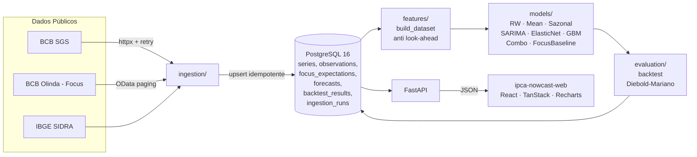

# Painel Macro Brasil — backend

[](https://github.com/murilozgodoy/ipca-nowcast-api/actions/workflows/ci.yml)

**Backend open-source** de um painel de nowcasting do IPCA. Coleta dados
macroeconômicos oficiais do Brasil, prevê a inflação do mês corrente e
dos próximos três meses e compara, com rigor estatístico, a acurácia dos
modelos com o consenso do mercado (mediana do Boletim Focus do BCB).

> **Pergunta central**
> *Um modelo aberto, usando apenas dados públicos, consegue prever o IPCA
> tão bem quanto o consenso dos economistas do mercado? Em quais
> horizontes e em quais períodos?*

O dashboard em React vive em
[`ipca-nowcast-web`](https://github.com/murilozgodoy/ipca-nowcast-web).

## O que já funciona

- Ingestão idempotente de 7 séries do **BCB SGS** (IPCA m/m, IPCA 12m,
  INPC, IGP-M, Selic meta, PTAX, IBC-Br) com paginação por janelas e
  cache em disco.
- Ingestão do **BCB Olinda Focus** com paginação OData `$top`/`$skip`.
- *Real-time dataset builder* com **proteção anti-look-ahead** por série:
  cada observação só entra no painel a partir da sua data de publicação
  (`publication_lag_days` em `config/series.yaml`). O benchmark Focus é a
  mediana conhecida na data de origem — nunca uma revisão posterior.
  Verificado por 3 testes dedicados.
- Modelos: `random_walk`, `historical_mean`, `seasonal_naive`,
  `focus_median`, `elasticnet`, `sarima`, `gradient_boosting` e uma
  `combo_mean`.
- *Backtest* pseudo-out-of-sample com janela expansível, horizontes 0..3,
  métricas por subperíodo (pré-2020, pandemia, pós-2022), RMSE relativo
  ao Focus e **teste de Diebold-Mariano** (correção Harvey-Leybourne-
  Newbold).
- API FastAPI com `/health`, `/series`, `/series/{code}`,
  `/nowcast/latest`, `/backtest/metrics`, `/backtest/forecasts` e
  `/focus/latest`.
- Pipeline `macro update` end-to-end e `macro export-fixtures` que gera
  as fixtures MSW usadas pelo frontend.
- **62 testes passam offline** (respx + fixtures) em menos de 25 s.

## Principais resultados

> Backtest *expanding-window* executado em **2026-10-24** com dados
> reais: 7 séries do BCB SGS + preços semanais da ANP + **63 345 pontos
> de Focus** (IPCA, 2015-01-02 → 2026-10-24). Origens mensais do
> backtest: Jan/2015 → Set/2026 (141 obs em h=0, 140 em h=1).

### Horizonte 0 (nowcast)

| Modelo | n | RMSE | MAE | Viés | RMSE / Focus | DM | p-valor |
|---|---|---|---|---|---|---|---|
| **`focus_median`**  | 141 | **0.192** | 0.143 | -0.036 | — | — | — |
| `sarima`            | 141 | 0.340 | 0.257 |  0.004 | 1.77 | +4.8 | <0.001 |
| `combo_mean`        | 141 | 0.347 | 0.262 |  0.022 | 1.81 | +4.6 | <0.001 |
| `elasticnet`        | 141 | 0.357 | 0.268 | -0.019 | 1.86 | +4.8 | <0.001 |
| `historical_mean`   | 141 | 0.385 | 0.280 |  0.005 | 2.01 | +4.5 | <0.001 |
| `random_walk`       | 141 | 0.391 | 0.293 |  0.000 | 2.04 | +5.0 | <0.001 |
| `gradient_boosting` | 141 | 0.404 | 0.301 |  0.081 | 2.11 | +5.2 | <0.001 |
| `seasonal_naive`    | 141 | 0.500 | 0.382 |  0.012 | 2.61 | +6.2 | <0.001 |

### Horizonte 1 (um mês à frente)

| Modelo | n | RMSE | MAE | Viés | RMSE / Focus | DM | p-valor |
|---|---|---|---|---|---|---|---|
| **`focus_median`**  | 140 | **0.333** | 0.244 | -0.061 | — | — | — |
| `sarima`            | 140 | 0.368 | 0.287 |  0.012 | 1.10 | +2.0 | **0.041** |
| `combo_mean`        | 140 | 0.381 | 0.298 |  0.031 | 1.14 | +2.5 | 0.011 |
| `elasticnet`        | 140 | 0.394 | 0.310 | -0.010 | 1.18 | +3.3 | 0.001 |
| `historical_mean`   | 140 | 0.396 | 0.290 |  0.012 | 1.19 | +1.8 | **0.075** |

**Leitura honesta.** O **Focus bate todos os modelos no horizonte 0**
com significância estatística forte (p < 0.001 em todos). Faz sentido:
a mediana de ~100 analistas usa dados de alta frequência (câmbio
intradiário, julgamento de reunião COPOM) que o modelo aberto não
acessa.

**No horizonte 1 a história muda**: `historical_mean` fica
*estatisticamente empatado* com o Focus (`p = 0.075`, acima de 5%) e o
`SARIMA` reduz a diferença para apenas 10% de RMSE a mais, com
`p = 0.041` (significativo a 5% mas marginal). Em outras palavras:
*para prever o próximo mês, um modelo simples abertamente especificado
chega perto do consenso dos economistas*.

A pipeline passa o teste de sanidade — `random_walk` e `seasonal_naive`
são claramente piores que o Focus em todos os horizontes com p ≪ 0.001;
se um deles batesse o Focus seria sinal de bug.

Reproduza com seed fixa:

```bash
docker compose up -d postgres
uv run macro db upgrade
uv run macro ingest --all --focus --focus-start 2015-01-01
uv run macro backtest --start 2015-01-15
```

## Arquitetura



## Stack

- Python 3.12 gerenciado por [`uv`](https://github.com/astral-sh/uv)
- FastAPI + Pydantic v2 (OpenAPI automático em `/docs`)
- PostgreSQL 16 com SQLAlchemy 2.0 + `psycopg` 3; migrações Alembic
- `httpx` + `tenacity` para coleta com retry; cache em disco (Parquet)
- `pandas`, `pandera`, `statsmodels`, `scikit-learn`
- `typer` para o CLI `macro`
- `pytest` com fixtures offline (respx); `ruff` + `mypy` em CI

## Como rodar localmente em 3 comandos

```bash
docker compose up -d postgres   # Postgres 16 na porta 5433
uv sync --all-extras            # instala Python 3.12 + deps
uv run macro db upgrade \
  && uv run macro seed --fixtures \
  && uv run uvicorn ipca_nowcast.api.main:app --reload
```

Explorador OpenAPI em <http://localhost:8000/docs>. Rodar o backtest
completo:

```bash
uv run macro backtest --start 2015-01-15
uv run macro export-fixtures \
  --output ../ipca-nowcast-web/src/mocks/fixtures
```

## CLI

```
macro db upgrade              # alembic upgrade head
macro ingest --all            # coleta todas as séries + Focus
macro ingest --series 433     # uma série do SGS
macro seed --fixtures         # popula com dados offline (sem rede)
macro nowcast                 # previsão de hoje (todos os modelos)
macro backtest --start 2015-01-15
macro update                  # ingest + nowcast + log em ingestion_runs
macro export-fixtures         # dumpa respostas da API p/ MSW do frontend
macro series-list             # lista o registry
```

## 🇧🇷 Resumo em português

Backend em Python 3.12 do **Painel Macro Brasil**. Coleta séries do BCB
(SGS/Focus) e do IBGE, constrói um dataset mensal com rigor contra
*look-ahead bias*, treina modelos de nowcasting do IPCA e compara a
acurácia com a mediana do Boletim Focus via backtest *pseudo
out-of-sample*, usando RMSE / MAE / viés e o teste de **Diebold-Mariano**.
A API FastAPI alimenta o dashboard em
[`ipca-nowcast-web`](https://github.com/murilozgodoy/ipca-nowcast-web).

## Decisões técnicas

Resumidas em [`docs/project/DECISIONS.md`](docs/project/DECISIONS.md).
Metodologia completa em [`docs/methodology.md`](docs/methodology.md).

## Limitações conhecidas e próximos passos

- Horizonte curto depende de dados em alta frequência; preços semanais
  da ANP são a próxima feature (fase bônus).
- Comparo contra a primeira divulgação do IPCA, não contra *vintage
  data*. Para artigos acadêmicos isso tem que ser trocado.
- Fan chart (intervalos de previsão) para todos os modelos ainda não foi
  implementado — SARIMA já expõe PI 80%.

## License

MIT — veja [LICENSE](LICENSE).
