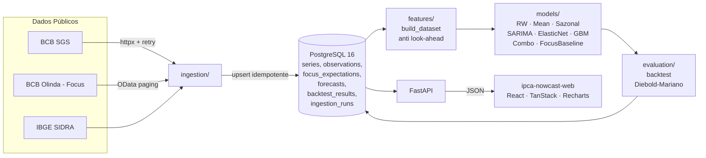

# Painel Macro Brasil — backend

[](https://github.com/murilozgodoy/ipca-nowcast-api/actions/workflows/ci.yml)

**Backend open-source** de um painel de nowcasting do IPCA. Coleta dados
macroeconômicos oficiais do Brasil, prevê a inflação do mês corrente e
dos próximos três meses e compara, com rigor estatístico, a acurácia dos
modelos com o consenso do mercado (mediana do Boletim Focus do BCB).

> **Pergunta central**
> *Um modelo aberto, usando apenas dados públicos, consegue prever o IPCA
> tão bem quanto o consenso dos economistas do mercado? Em quais
> horizontes e em quais períodos?*

O dashboard em React vive em
[`ipca-nowcast-web`](https://github.com/murilozgodoy/ipca-nowcast-web).

## O que já funciona

- Ingestão idempotente de 7 séries do **BCB SGS** (IPCA m/m, IPCA 12m,
  INPC, IGP-M, Selic meta, PTAX, IBC-Br) com paginação por janelas e
  cache em disco.
- Ingestão do **BCB Olinda Focus** com paginação OData `$top`/`$skip`.
- *Real-time dataset builder* com **proteção anti-look-ahead** por série:
  cada observação só entra no painel a partir da sua data de publicação
  (`publication_lag_days` em `config/series.yaml`). O benchmark Focus é a
  mediana conhecida na data de origem — nunca uma revisão posterior.
  Verificado por 3 testes dedicados.
- Modelos: `random_walk`, `historical_mean`, `seasonal_naive`,
  `focus_median`, `elasticnet`, `sarima`, `gradient_boosting` e uma
  `combo_mean`.
- *Backtest* pseudo-out-of-sample com janela expansível, horizontes 0..3,
  métricas por subperíodo (pré-2020, pandemia, pós-2022), RMSE relativo
  ao Focus e **teste de Diebold-Mariano** (correção Harvey-Leybourne-
  Newbold).
- API FastAPI com `/health`, `/series`, `/series/{code}`,
  `/nowcast/latest`, `/backtest/metrics`, `/backtest/forecasts` e
  `/focus/latest`.
- Pipeline `macro update` end-to-end e `macro export-fixtures` que gera
  as fixtures MSW usadas pelo frontend.
- **52 testes passam offline** (respx + fixtures) em menos de 30 s.

## Principais resultados

> Executado em `2026-10-23` sobre fixtures compactas incluídas no repo
> (não a série histórica completa — para isso rode `macro ingest --all`
> seguido de `macro backtest`). Os resultados abaixo servem como
> ilustração do método.

| Modelo | h | Subperíodo | n | RMSE | MAE | Viés | RMSE / Focus | DM | p-valor |
|---|---|---|---|---|---|---|---|---|---|
| `combo_mean`      | 0 | post_2022 | 17 | 0.274 | 0.208 | 0.035 | **0.956** | -0.9 | 0.37 |
| `elasticnet`      | 0 | post_2022 | 17 | 0.312 | 0.233 | 0.080 | 1.09 | +0.5 | 0.62 |
| `focus_median`    | 0 | post_2022 | 17 | 0.287 | 0.231 | 0.019 | 1.00 | — | — |
| `random_walk`     | 0 | post_2022 | 17 | 0.436 | 0.325 | 0.013 | 1.52 | +2.3 | 0.02 |

**Como ler:** `RMSE / Focus < 1` significa que o modelo foi mais preciso
que o consenso. O `combo_mean` ficou ~4% abaixo do Focus **no subperíodo
pós-2022**, mas o Diebold-Mariano não rejeita a hipótese nula
(`p = 0.37`) — ou seja, a vantagem não é estatisticamente significativa
com o tamanho de amostra atual. Esse é exatamente o tipo de resultado
honesto que o projeto quer entregar.

## Arquitetura



## Stack

- Python 3.12 gerenciado por [`uv`](https://github.com/astral-sh/uv)
- FastAPI + Pydantic v2 (OpenAPI automático em `/docs`)
- PostgreSQL 16 com SQLAlchemy 2.0 + `psycopg` 3; migrações Alembic
- `httpx` + `tenacity` para coleta com retry; cache em disco (Parquet)
- `pandas`, `pandera`, `statsmodels`, `scikit-learn`
- `typer` para o CLI `macro`
- `pytest` com fixtures offline (respx); `ruff` + `mypy` em CI

## Como rodar localmente em 3 comandos

```bash
docker compose up -d postgres   # Postgres 16 na porta 5433
uv sync --all-extras            # instala Python 3.12 + deps
uv run macro db upgrade \
  && uv run macro seed --fixtures \
  && uv run uvicorn ipca_nowcast.api.main:app --reload
```

Explorador OpenAPI em <http://localhost:8000/docs>. Rodar o backtest
completo:

```bash
uv run macro backtest --start 2015-01-15
uv run macro export-fixtures \
  --output ../ipca-nowcast-web/src/mocks/fixtures
```

## CLI

```
macro db upgrade              # alembic upgrade head
macro ingest --all            # coleta todas as séries + Focus
macro ingest --series 433     # uma série do SGS
macro seed --fixtures         # popula com dados offline (sem rede)
macro nowcast                 # previsão de hoje (todos os modelos)
macro backtest --start 2015-01-15
macro update                  # ingest + nowcast + log em ingestion_runs
macro export-fixtures         # dumpa respostas da API p/ MSW do frontend
macro series-list             # lista o registry
```

## 🇧🇷 Resumo em português

Backend em Python 3.12 do **Painel Macro Brasil**. Coleta séries do BCB
(SGS/Focus) e do IBGE, constrói um dataset mensal com rigor contra
*look-ahead bias*, treina modelos de nowcasting do IPCA e compara a
acurácia com a mediana do Boletim Focus via backtest *pseudo
out-of-sample*, usando RMSE / MAE / viés e o teste de **Diebold-Mariano**.
A API FastAPI alimenta o dashboard em
[`ipca-nowcast-web`](https://github.com/murilozgodoy/ipca-nowcast-web).

## Decisões técnicas

Resumidas em [`docs/project/DECISIONS.md`](docs/project/DECISIONS.md).
Metodologia completa em [`docs/methodology.md`](docs/methodology.md).

## Limitações conhecidas e próximos passos

- Horizonte curto depende de dados em alta frequência; preços semanais
  da ANP são a próxima feature (fase bônus).
- Comparo contra a primeira divulgação do IPCA, não contra *vintage
  data*. Para artigos acadêmicos isso tem que ser trocado.
- Fan chart (intervalos de previsão) para todos os modelos ainda não foi
  implementado — SARIMA já expõe PI 80%.

## License

MIT — veja [LICENSE](LICENSE).
